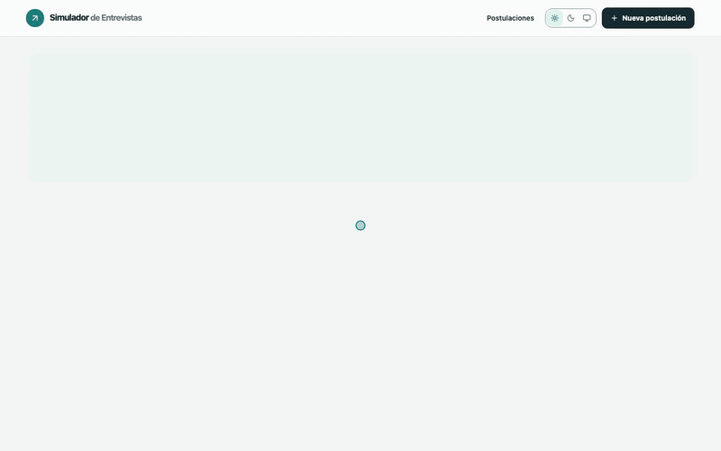
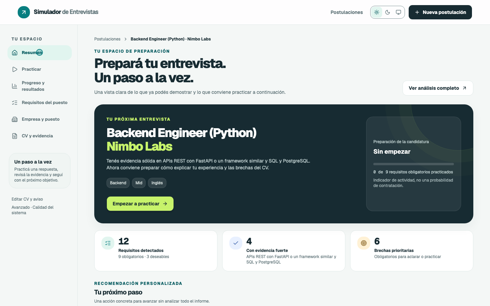
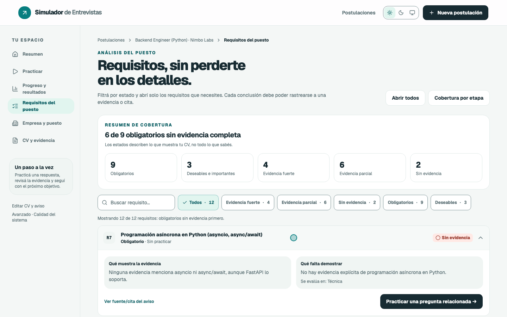
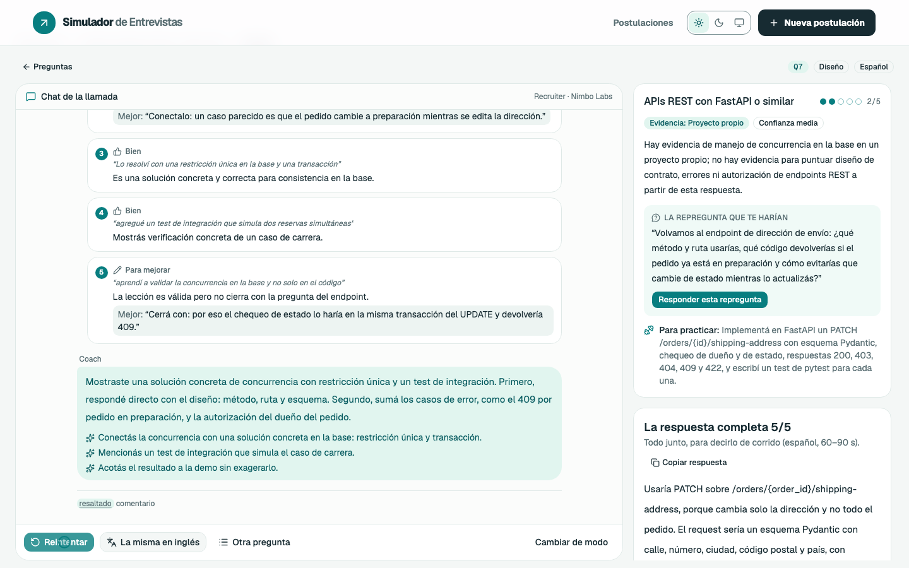
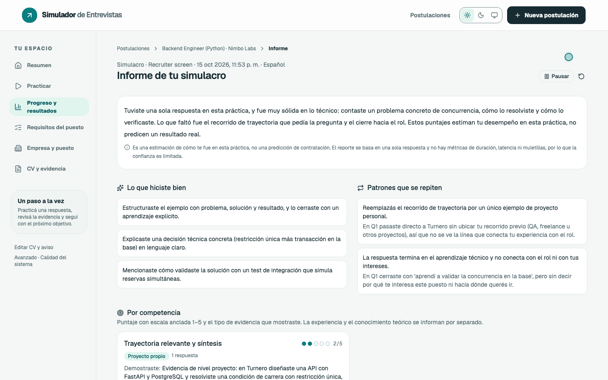

# Interview Simulator

[](https://github.com/AndJunes/simulador-entrevistas/actions/workflows/ci.yml)


*Read this in [Spanish / Español](README.es.md).*

A personal, local-first AI interview simulator. You upload **a real job posting and your
CV**; the app analyzes what the role asks for and what evidence your CV shows, builds a
question bank per interview stage, and interviews you by voice (or in writing). Then it
gives you feedback on **what you say** (competencies and criteria on anchored scales) and
**how you sound** (latency, pace, pauses, filler words).

> The product UI is in Spanish by design — it's a tool I built for my own job hunt. The
> interview itself can be run in English or Spanish, and the RAG corpus ships in both
> languages.

## Demo



*A sped-up tour using the fictional data in [`examples/`](examples/): create an
application, review requirements and evidence, practice a question answering in writing,
run a mock interview and read the report.*

| Application summary | Requirements |
|---|---|
|  |  |
| **Feedback on a practice answer** | **Mock interview report** |
|  |  |

## The problem it solves

Interview prep usually means generic question lists and zero feedback. This project:

- derives the questions from the **actual posting** and **your CV**, distinguishing work
  experience from personal projects;
- marks which requirements have strong, partial or no evidence **in the CV** (not in the
  person);
- simulates the interview by stage (recruiter screen, technical, behavioral/client) with
  follow-ups only when evidence is missing;
- scores every answer with quotes from what you said, separating what you demonstrated
  from what's missing.

## Features

| Area | What it does |
|---|---|
| Applications | Each one holds its CV, posting, questions and results. Upload PDF, Word, RTF, ODT, TXT, Markdown, HTML, a scanned image, raw text or a link; everything becomes editable Markdown |
| Question generation | Staged pipeline: role analysis → CV evidence → coverage map → per-stage blueprint → candidates → validator (ungrounded premises, double-barreled or leading questions, duplicates, must-have coverage) |
| Per-question practice | Coach mode with hints revealed one at a time, retry with comparison, and language switching |
| Mock interview | Stage by stage, with 0–3 adaptive follow-ups (LangGraph) and a final report by competency |
| Video-call mode | The mock with the question spoken only, voice controls and a hideable clock |
| Written exercise | A work-sample task with clarifying questions; code is **never executed**, it's evaluated by reading |
| Progress | Evolution per competency and criterion against your own attempts |
| System quality | Metrics for the generator, the interviewer and the evaluator, fed by your ratings |

Every answer can be given **by voice or in writing**.

## Stack

| Layer | Technologies |
|---|---|
| Frontend | React 19, TypeScript, Vite 8, Tailwind CSS v4, shadcn/ui (Radix), TanStack Query, React Router, Motion |
| Backend | Python 3.12, FastAPI, SSE, LangGraph, SQLAlchemy 2 + Alembic |
| Database | Postgres 17 + pgvector 0.8.7 (Docker) |
| AI | OpenRouter (Claude Sonnet 5.5 evaluates, Haiku 5.5 for fast tasks), NVIDIA (Magpie TTS, nemotron embeddings), **local** Whisper large-v3-turbo (MLX) |
| Tests | pytest, Vitest, Playwright + axe-core |

## Architecture

```
browser (React)
   │  REST + SSE (progress of generation, evaluation and reports)
   ▼
FastAPI ── LangGraph (mock interview) ── services (practice, mock, exercise, quality)
   │            ├─ OpenRouter: analysis, questions, evaluation, follow-ups (text only)
   │            ├─ NVIDIA: interviewer voice (TTS) and embeddings of the public corpus
   │            └─ local Whisper (MLX): transcription; audio never leaves the machine
   ▼
Postgres + pgvector: applications, sessions, turns, evaluations and the RAG corpus
```

```
backend/
  app/
    core/ db/             configuration, SQLAlchemy models and session
    ingest/               document-to-Markdown conversion and link download (anti-SSRF)
    generation/           question pipeline: analysis, evidence, blueprint, validator
    interview/            mock interview graph (LangGraph)
    pipeline/             STT, TTS, voice metrics, evaluator, coach, LLM client
    rag/                  incremental ingestion and retrieval over pgvector
    services/             use cases (practice, mock, exercise, quality)
    main.py               HTTP endpoints
  config/                 filler words and target ranges (with sources)
  migrations/             Alembic
  tests/
frontend/src/
  pages/                  screens (applications, application space, sessions)
  components/             own components + ui/ (shadcn)
  lib/                    API client, audio, theme, the "next step" rule
knowledge/                RAG corpus (rubrics, questions, pitfalls) with 45 sources in SOURCES.md
evals/                    generator eval (A/B over 30 fictional cases) and evaluator consistency
examples/                 fictional CV and postings to try the full flow
```

## Prerequisites

- Python 3.12+, [uv](https://docs.astral.sh/uv/), Node.js 20.19+ or 22.12+, Docker (or OrbStack).
- API keys for [OpenRouter](https://openrouter.ai/settings/keys) and
  [NVIDIA](https://build.nvidia.com).
- Binaries: `pdftotext` (poppler) for PDF ingestion; `ffmpeg` for voice answers.
- **Voice transcription only: macOS on Apple Silicon** — it uses MLX (Metal GPU), installed
  as an optional dependency group. Everywhere else the backend runs in **text mode**: you
  answer in writing, and `/api/health` reports STT as unavailable. Converting DOCX/RTF/ODT
  also relies on macOS (`textutil`); PDF, TXT, MD, images and links work anywhere.

## Install

```bash
cp .env.example .env                 # fill in POSTGRES_PASSWORD, OPENROUTER_API_KEY and NVIDIA_API_KEY
cd backend && uv sync                # text mode
uv sync --group stt                  # + local voice transcription (Apple Silicon)
cd ../frontend && npm ci
```

The first transcription downloads the Whisper weights at the revision pinned in `.env`
and verifies their hash (`STT_LOCAL_WEIGHTS_SHA256_PREFIX`).

## Run

```bash
./dev.sh
```

Starts Postgres (Docker), applies migrations, boots the backend on `127.0.0.1:8000` and
the frontend on `http://127.0.0.1:5173`. On startup the backend indexes the `knowledge/`
corpus (it only re-embeds what changed). `Ctrl+C` stops backend and frontend; the
database keeps running (`docker compose down` to stop it).

Off macOS — or to try the API without installing Python — the text-mode backend also
runs as a container (database + migrations + API):

```bash
docker compose --env-file .env --profile api up -d
```

## Try it with the example data

[`examples/`](examples/) ships a **fictional** CV and three fictional postings (Python
backend, AI engineer, full stack). In the app: **New application** → upload
`examples/cv-ejemplo.md` as the CV and one of the postings as the role. Generation takes
~2–3 minutes and costs ~US$0.60 on OpenRouter.

## Environment variables

Everything is documented in [`.env.example`](.env.example). The main ones:

| Variable | Purpose |
|---|---|
| `POSTGRES_PASSWORD` | Local database password |
| `OPENROUTER_API_KEY` | LLM: analysis, questions, evaluation |
| `NVIDIA_API_KEY` | Interviewer voice and embeddings |
| `LLM_EVALUATOR_MODEL`, `LLM_FAST_MODEL` | OpenRouter models |
| `OPENROUTER_DATA_COLLECTION` | `deny`: only providers that don't retain data |

## Tests and checks

```bash
cd backend && uv run pytest
cd frontend && npm test                           # Vitest: token contrast and the next-step rule
cd frontend && npm run lint                       # oxlint
cd frontend && npm run build                      # tsc + production build
cd frontend && npm run test:e2e                   # Playwright + axe (needs ./dev.sh running)
```

The backend tests cover voice metrics, VAD, filler words, the evaluator (criterion
applicability, competencies), rubrics, the mock graph (follow-ups, justified skips, mixed
language), the blueprint, the premise validator, candidate selection, per-application
context, document converters, SSRF blocking and written answers. The e2e suite runs
axe-core (WCAG 2.2 AA) over 11 screens in light and dark themes, 320 px reflow, keyboard,
filters, search and reduced motion.

Evals with a cost (they call the LLM):

```bash
backend/.venv/bin/python evals/run_generator.py --limit 3                       # ~US$0.58 per case
backend/.venv/bin/python evals/run_evaluator_consistency.py --n 5 --repeats 2   # ~US$0.90
```

## Main API

| Method | Route | What it does |
|---|---|---|
| `POST` | `/api/ingest` | Converts a file, raw text or link to Markdown |
| `POST` / `GET` | `/api/applications` | Creates (and generates questions) / lists applications |
| `GET` / `PATCH` / `DELETE` | `/api/applications/{id}` | Detail, edit and delete |
| `GET` | `/api/applications/{id}/events` | SSE with generation progress |
| `GET` | `/api/applications/{id}/context?view=coach\|mock` | Questions; `mock` never sends hints or expected evidence |
| `POST` | `/api/practice/turns` | A practice answer (audio or text) |
| `GET` | `/api/turns/{id}/events` | SSE with the staged evaluation |
| `POST` | `/api/mock/sessions`, `…/{id}/answer`, `…/{id}/finish` | Mock interview |
| `POST` | `/api/exercise/sessions`, `…/{id}/clarify`, `…/{id}/submit` | Written exercise |
| `GET` | `/api/progress`, `/api/sessions`, `/api/quality` | Progress, history and system metrics |
| `GET` | `/api/health` | STT and RAG status |

## Privacy and security

- Audio is transcribed locally and deleted as soon as it's processed; only text is stored.
- Only text goes to OpenRouter, with `data_collection: deny`. The CV is never sent to NVIDIA.
- Link ingestion accepts only http/https and blocks internal and local addresses
  (anti-SSRF), with size limits.
- In the generation, coach and evaluation prompts, the CV, the posting and your answers
  are delimited as data, never as instructions.
- The mock requests `view=mock`: expected evidence, hints and the follow-up policy never
  reach the browser.
- API and database listen on `127.0.0.1` only. **There is no authentication**: it's built
  for a single person running it locally.
- `data/private/` (CVs, postings, results with answers) and test audio are never committed.

## Known limitations

- Local voice transcription requires Apple Silicon; elsewhere the backend runs in text
  mode. There's no deployment of the backend.
- Single-person local use: no auth and no LLM spending cap. Background work is
  bounded (6 concurrent jobs, 429 beyond that) and a restart turns in-flight work
  into retryable errors, but SSE progress streams live in memory.
- Analysis quality depends on the LLM: evidence states describe the CV and may contain
  model inferences.
- The NVIDIA endpoints used are trial endpoints (their terms log input/output).

## License

All rights reserved — the code is published for review, with an explicit exception that
allows cloning and running it locally for technical evaluation or hiring purposes. See
[`LICENSE`](LICENSE).

Third-party assets: [unDraw](https://undraw.co/license) illustrations (decorative use,
modified) and the Geist and Geist Mono fonts (OFL).
